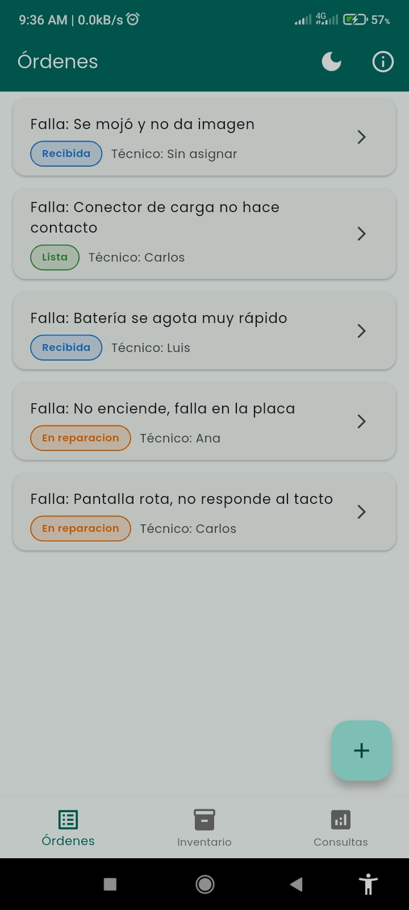
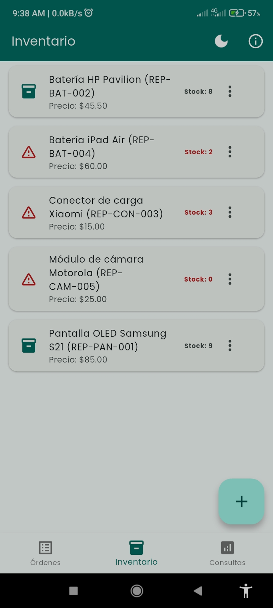
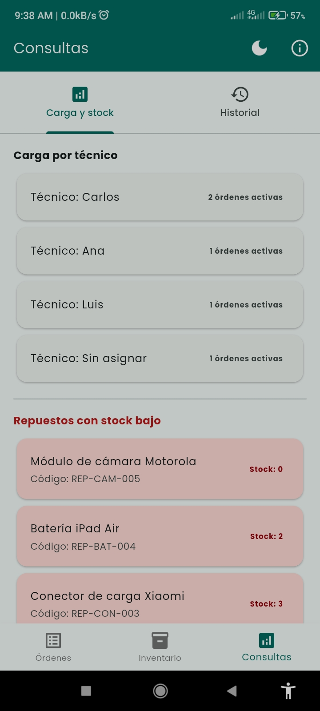
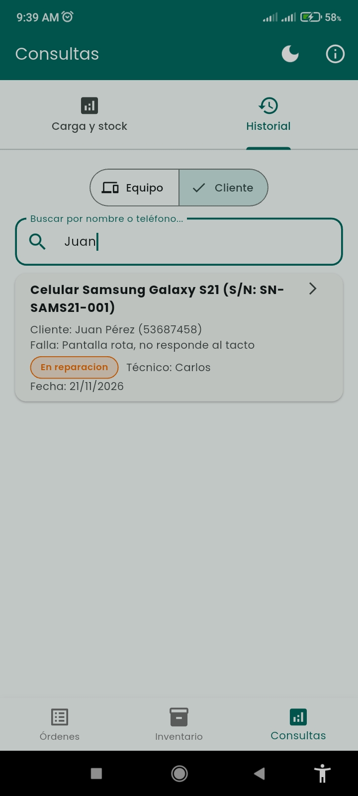
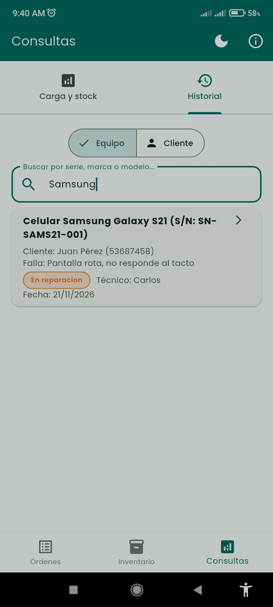
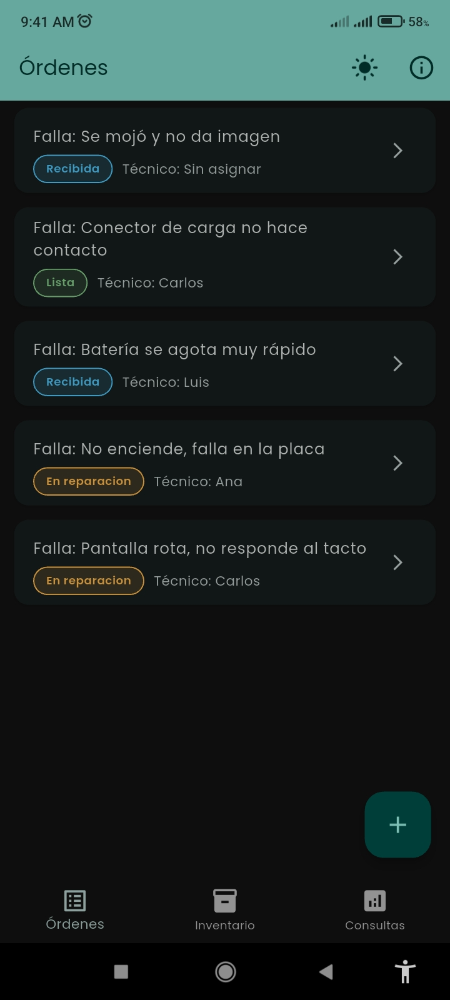

<h1 align="center">Tu Solution - Gestión de Taller de Reparaciones</h1>

  Proyecto práctico para la asignatura <b>Programación para Dispositivos Móviles</b> (Ingeniería Informática, 3er año).

---

<h2>Descripción</h2>

<b>Tu Solution</b> es una aplicación Flutter para Android que gestiona las reparaciones de un taller de dispositivos electrónicos (celulares, tablets y laptops). Permite registrar clientes y equipos, crear órdenes de reparación, asignar técnicos, controlar el inventario de repuestos y consultar el historial de reparaciones. Toda la información se guarda localmente en SQLite mediante Drift, por lo que funciona sin conexión a internet.

La aplicación es de uso exclusivo de los técnicos del taller: no hay autenticación, no hay interacción con clientes y no se envían notificaciones ni presupuestos desde la app.

<h2>Tecnologías y Arquitectura</h2>
<ul>
  <li><b>Flutter</b>: Framework de desarrollo para Android.</li>
  <li><b>Drift</b>: Persistencia local en SQLite con tipado fuerte, migraciones y consultas reactivas (<code>watch</code>).</li>
  <li><b>Riverpod</b>: Gestión de estado reactiva con <code>StreamProvider</code> y <code>AsyncNotifier</code>.</li>
  <li><b>MVVM</b>: Separación en DAO, ViewModels y Views.</li>
  <li><b>Material 3</b>: Tema claro/oscuro con tipografía Poppins y persistencia del modo con <code>shared_preferences</code>.</li>
</ul>

<h2>Requisitos e Instalación</h2>

<h3>Versión de Flutter</h3>

El proyecto fue desarrollado y compilado con <b>Flutter estable (3.x)</b>.

<h3>Application ID</h3>

El identificador de la aplicación es:  
<code>com.yosbielalejandro.diazcala.tusolution</code>

<h3>Cómo inicializar y ejecutar el proyecto</h3>
<ol>
  <li>Clona el repositorio:  <code>git clone https://github.com/Yosbiel/Yosbiel-A.-Taller-Tu-Solution-2do-Parcial.git</code></li>
  <li>Accede al directorio:  <code>cd Yosbiel-A.-Taller-Tu-Solution-2do-Parcial</code></li>
  <li>Obtén las dependencias:  <code>flutter pub get</code></li>
  <li>Genera los archivos de Drift:  <code>dart run build_runner build --delete-conflicting-outputs</code></li>
  <li>Ejecuta la app en un emulador o dispositivo físico:  <code>flutter run</code></li>
</ol>

<h3>Cómo generar el APK en modo Release</h3>

Para generar el archivo instalable, ejecuta:

<pre><code>flutter build apk --release --split-per-abi</code></pre>

El APK se generará en la ruta:  
<code>build/app/outputs/flutter-apk/</code>

<h2>Estructura de Carpetas</h2>

El código está organizado manteniendo la separación de responsabilidades de MVVM:

<ul>
  <li><code>assets/</code>: Recursos estáticos (fuentes Poppins).</li>
  <li><code>capturas/</code>: Capturas reales de la app en funcionamiento.</li>
  <li><code>lib/</code>:
    <ul>
      <li><code>data/database/</code>: Configuración de Drift, tablas y migraciones.</li>
      <li><code>data/daos/</code>: Acceso a datos (<code>TalleresDao</code>) y excepciones personalizadas.</li>
      <li><code>viewmodels/</code>: Providers de Riverpod y ViewModels.</li>
      <li><code>views/screens/</code>: Pantallas de la interfaz.</li>
      <li><code>views/widgets/</code>: Widgets reutilizables y estilos de estado.</li>
    </ul>
  </li>
</ul>

<h2>Funcionalidades</h2>
<ul>
  <li><b>Órdenes</b>: crear orden con cliente, equipo y falla reportada. Flujo de estados <code>recibida</code> → <code>en_reparacion</code> → <code>lista</code> → <code>entregada</code>, con <code>cancelada</code> disponible.</li>
  <li><b>Técnico responsable</b>: dropdown con los 3 técnicos (Carlos, Ana, Luis). Si la orden está <code>en_reparacion</code> y ya la tiene otro técnico, se bloquea la reasignación hasta liberarla.</li>
  <li><b>Reparación</b>: registrar mano de obra y añadir repuestos del almacén. El stock se descuenta automáticamente. Costo total = mano de obra + repuestos.</li>
  <li><b>Inventario</b>: CRUD de repuestos con validación de código único y alerta visual de stock bajo (≤ 3).</li>
  <li><b>Consultas</b>: carga de trabajo por técnico (mostrando nombres reales), repuestos con stock bajo, e historial con búsqueda reactiva y selector <b>Equipo / Cliente</b>.</li>
</ul>

<h2>Decisiones de Diseño y Optimización</h2>
<ul>
  <li><b>Bloqueo de reasignación de equipo</b>: si llega un equipo con serie existente pero otro dueño, la app bloquea el registro silencioso y muestra un diálogo claro usando excepciones personalizadas.</li>
  <li><b>Transiciones validadas</b>: no se permiten retrocesos (<code>entregada</code> → <code>recibida</code>) ni cambios desde estados finales.</li>
  <li><b>Stock con transacción</b>: al añadir un repuesto se relee el stock dentro de la transacción para evitar condiciones de carrera.</li>
  <li><b>Integridad referencial</b>: se activa <code>PRAGMA foreign_keys = ON</code> en la conexión SQLite para garantizar que las relaciones se cumplan.</li>
  <li><b>Código sin duplicación</b>: los mapeadores del DAO reutilizan la lógica de conversión de filas SQL a objetos Dart para las versiones <code>Future</code> y <code>Stream</code>.</li>
  <li><b>Búsqueda reactiva</b>: filtros de historial con debounce de 300 ms.</li>
  <li><b>Tema persistente</b>: el modo claro/oscuro se guarda con <code>shared_preferences</code>.</li>
  <li><b>Técnicos fijos</b>: el enunciado especifica 3 técnicos; se siembran en la primera ejecución.</li>
  <li><b>Sin autenticación</b>: la app es de uso interno del taller, según el enunciado.</li>
</ul>

<h2>Capturas de Pantalla</h2>

Las capturas reales de la aplicación corriendo se encuentran en la carpeta <a href="capturas/">capturas/</a>:

<table align="center">
  <tr>
    <td align="center"><b>Órdenes Abiertas</b> </td>
    <td align="center"><b>Detalle de Orden</b> </td>
    <td align="center"><b>Inventario</b> </td>
  </tr>
  <tr>
    <td align="center"><b>Carga y Stock</b> </td>
    <td align="center"><b>Historial por Cliente</b> </td>
    <td align="center"><b>Historial por Equipo</b> </td>
  </tr>
  <tr>
    <td align="center" colspan="3"><b>Modo Oscuro</b> </td>
  </tr>
</table>

---

<i>Desarrollado por Yosbiel Alejandro Díaz Cala.</i>

